<!-- Animated SVGs in assets/ are built by assets/make_svgs.py; edit the text there and re-run it. -->

<!-- <picture> stops GitHub from turning the image into a link; the Portfolio button below is the link. -->
<picture>
  
</picture>

  
  
  
  

## 🧑‍💻 About me

🎓 Final-year Computer Science & Engineering student at **East West University, Dhaka** — majoring in Data Science & Artificial Intelligence (graduating 2027)

🚀 Designed, built and deployed a **production student management system** end to end — React, Node.js, Express, MongoDB, PM2 and Nginx

🤖 Building **retrieval-augmented generation (RAG)** apps with hybrid search and locally hosted LLMs

📍 Based in Dhaka, Bangladesh

💼 Open to **freelance projects** and **full-time roles** in software development, ML and AI

## 🛠️ Tech stack

| Area | Tools |
| :---: | :---: |
| **Languages** | Python · C/C++ · JavaScript · TypeScript · SQL · Java |
| **AI & Data** | Machine Learning · PyTorch · Pandas · Transformers · LLMs · RAG · ChromaDB |
| **Web & Backend** | React · Node.js · Express · REST APIs · MongoDB · PostgreSQL |
| **Tools & Deployment** | Git · GitHub · Docker · Linux · Nginx · PM2 · Coolify |

## 🌟 Featured work

<table>
  <tr>
    <td width="33%" valign="top" align="center">
      <h4>🍳 <a href="https://CookedByAdor.com">Cooked by Ador</a></h4>
      <b>Freelance · 2026 – present</b>
      
A full-stack student management system for a coaching business, taken from requirements to production launch.

      

        <ul>
          <li>Role-based access for teachers, TAs and students</li>
          <li>Courses, attendance, assignments, grades and progress tracking</li>
          <li>Auth, file uploads, payments and downloadable grade reports</li>
          <li>Self-managed deployment with PM2 + Nginx</li>
        </ul>
      

      

        
        
        
        
      

      <a href="https://CookedByAdor.com"><b>Live site&nbsp;→</b></a>
    </td>
    <td width="33%" valign="top" align="center">
      <h4>📚 <a href="https://github.com/mishkat2025/rag-project-bluebook">EWU Bulletin RAG Assistant</a></h4>
      <b>Personal project · 2026</b>
      
A question-answering system for programs and policies in the East West University bulletin.

      

        <ul>
          <li>Hybrid retrieval: ChromaDB semantic search + BM25 keyword search</li>
          <li>Answers generated by a locally hosted Gemma model via LM Studio</li>
          <li>Responses grounded in the retrieved bulletin text</li>
        </ul>
      

      

        
        
        
        
      

      <a href="https://github.com/mishkat2025/rag-project-bluebook"><b>Source&nbsp;→</b></a>
    </td>
    <td width="33%" valign="top" align="center">
      <h4>🧮 <a href="https://cs2-everyone.sbmishkat10.workers.dev">CS² for Everyone</a></h4>
      <b>Personal project · 2026</b>
      
An interactive site that animates 28 computer science concepts one step at a time.

      

        <ul>
          <li>Classical ciphers, RSA, Diffie-Hellman and SHA-256, plus the attacks that break them</li>
          <li>Sorting, searching, data structures and BFS/DFS graph search</li>
          <li>Code panel in Python, Java, C++ or C highlights every step</li>
        </ul>
      

      

        
        
        
        
      

      <a href="https://cs2-everyone.sbmishkat10.workers.dev"><b>Live site&nbsp;→</b></a> · <a href="https://github.com/mishkat2025/cs2_everyone"><b>Source&nbsp;→</b></a>
    </td>
  </tr>
</table>

## 📊 GitHub stats

  
  

**Let's build something together** — reach me at [sbmishkat10@gmail.com](mailto:sbmishkat10@gmail.com)

